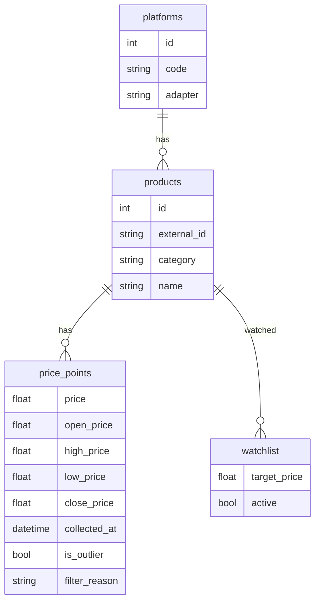

# 架构说明

## 1. 目标与边界

本系统是「硬件价格大盘」：**存储与展示本地可信价格序列**，辅以可解释预测与可选 LLM 解读。  
边界内：关注列表、清洗、图表、预测、DeepSeek、可插拔采集。  
边界外：不实现攻击型爬虫；不保证第三方平台实时价。

## 2. 模块一览

| 模块 | 路径 | 职责 |
|------|------|------|
| 入口 | `app/main.py` | FastAPI、静态页、生命周期里建表与调度 |
| 配置 | `app/config.py` | pydantic-settings，密钥仅来自环境变量 |
| 存储 | `app/db.py` + `models.py` | SQLite；Platform / Product / PricePoint / WatchItem |
| 业务 | `app/services.py` | 关注、写价点（含过滤）、图表、预测封装 |
| API | `app/api/*` | REST：health / watchlist / products / chart / analyze / collect |
| 采集 | `app/collectors/*` | Adapter 接口 + registry；mock / csv / http_json / 平台 stub |
| 清洗 | `app/cleaning/filters.py` | 不合理价判决 |
| 预测 | `app/forecast/models.py` | SMA / EMA / 线性；`Forecaster` Protocol 预留 |
| LLM | `app/llm/deepseek.py` | 在线探测 + Chat Completions |
| 调度 | `app/scheduler.py` | APScheduler 周期拉取关注商品 |
| UI | `templates/` + ECharts | 大盘列表 + 单品 **K 线**（蜡烛图 / MA / 缩放 / 预测半透明 K） |

## 3. 数据模型



- **Platform.adapter**：指向 collector registry 的 `code`
- **PricePoint.is_outlier**：过滤未通过仍落库（可审计），默认图表排除

## 4. 数据流

### 4.1 采价

```
Scheduler / POST /api/collect/*
  → get_adapter(platform.adapter)
  → get_price(external_id)
  → PriceFilter.check(price, clean_history)
  → INSERT price_points (is_outlier / filter_reason)
```

### 4.2 图表 & 预测（日 K）

```
GET /api/chart/{id}
  → 非 outlier 点 → 按日聚合 OHLC candles
  → MA7/MA30（基于收盘）
  → forecast_candles（预测中枢 ± 近期振幅 → o/h/l/c）
GET /api/chart/{id}/forecast
  → 同序列 → SMA|EMA|linear → 未来 N 天点 + candles
```

无完整 OHLC 字段时，同日多次 `price` 可推导：开=首、收=末、高=max、低=min。

### 4.3 AI 分析

```
GET /api/analyze/{id}
  → 本地 forecast + history_summary
  → is_online() & API Key?
       否 → AnalyzeOut.error = 离线/未配置说明（仍带 forecast）
       是 → DeepSeek chat → analysis 文本
```

## 5. 异常价过滤规则

实现：`PriceFilter`（阈值来自配置）。

| 规则 | 默认行为 |
|------|----------|
| 非正数 / 占位集合 | 拒：`0, 0.01, 1, 9.9, 9.99, 99, 999999…` |
| 绝对区间 | 默认 `[50, 100000]`（`FILTER_MIN/MAX_PRICE`） |
| 中位数偏离 | 历史 ≥3 点时，\|p−med\|/med > `0.55` 拒 |
| Z-score | 历史 ≥5 点时，\|z\| > `3.5` 拒 |
| 疑似虚假促销 | 历史 ≥3 且 p < 0.15×med 且 p < 100 拒 |

顺序过滤时，判决仅使用**此前已接受**的点，避免脏数据污染中位数。

Seed 脚本会故意写入 1 元、0.01、过高/过低价等，启动后可用：

```bash
# 含 outlier
curl -s 'http://127.0.0.1:8000/api/products/1/prices?include_outliers=true' | head
```

## 6. 预测设计

| 方法 | 思路 | 适用 |
|------|------|------|
| `sma` | 近窗均值 + 弱斜率外推 | 平稳序列 |
| `ema` | 指数平滑水平 + 弱 drift | 默认，跟新价更紧 |
| `linear` | 最小二乘时间回归 | 趋势明显时 |

`Forecaster` Protocol 便于后续接入 Prophet / 深度学习等，而不改 API 形状。

## 7. LLM Prompt 设计

- **System**：购入顾问角色；要求覆盖走势 / 是否继续降价 / 入手建议（观望|可买|谨慎）；禁止编造未提供数据。
- **User**：商品名、最新价、目标价、历史摘要、预测摘要。
- **失败语义**：`OfflineError` → HTTP 200 + `error` 字段（前端友好），避免与「服务挂了」混淆。

## 8. 采集器扩展

1. 实现 `CollectorAdapter`（`search` / `get_price`）
2. `register_adapter(实例)`
3. 在 `platforms` 表写入对应 `adapter` code  
4. 若为真实电商：优先官方 API；在 `compliance_note()` 写清授权范围

Stub 文件 `collectors/stubs.py` 中京东/淘宝/拼多多仅 `raise NotImplementedError` 并附 TODO 文案。

## 9. 安全

- API Key 只读环境变量，仓库仅 `.env.example`
- 不存储平台登录 Cookie
- Stub 与文档双重警示，降低误用为爬虫的风险

## 10. 已知限制与下一步

- Mock 价非真实市场；真对接需开放平台凭证
- 预测为短视统计，非投资/消费保证
- 单机 SQLite，无多用户权限模型
- 前端 CDN 拉 ECharts：完全离线浏览需改为本地静态包

**下一步建议**：选定一个平台申请开放平台 → 新写 `adapters/jd_open.py`（非爬虫）→ 映射 SKU 到 `external_id` → 用现有过滤与图表管道即可。
