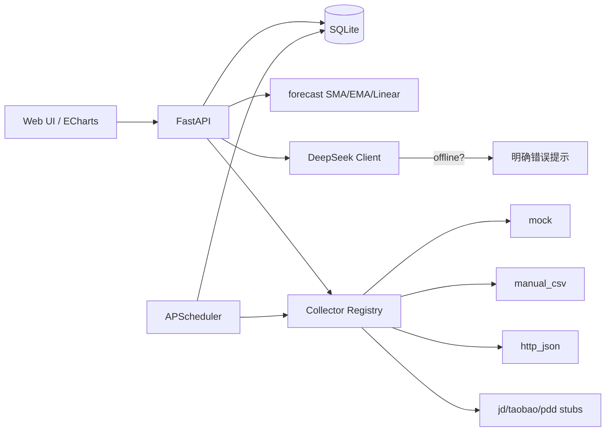

# 电脑硬件价格大盘（PC Hardware Tracker）

本地可运行的「电脑硬件价格跟踪」程序：关注 CPU / 显卡 / 主板 / 内存 / SSD / HDD，绘制类股市走势图、简单价格预测，并可选接入 **DeepSeek** 做入手分析。

> **合规声明**：淘宝 / 京东 / 拼多多没有稳定公开的免费商品价 API，且反爬严格。本项目**不包含**绕过登录、验证码或风控的攻击型爬虫。真实平台 adapter 仅为 **stub + TODO**，请使用开放平台、商家导出、自建合规数据源或 `mock` 演示。

## 功能

- **多品类关注**：CPU、GPU、主板、内存、SSD、HDD
- **走势图**：ECharts **蜡烛图（日 K）**、MA7/MA30、区间缩放；悬停/点击显示当日开高低收；预测段为半透明虚边 K 线
- **预测**：SMA / EMA / 线性趋势（可解释）；预留更强模型接口
- **DeepSeek 分析**：走势、是否可能降价、是否值得入手
- **离线可用**：本地 SQLite 历史价、图表、关注列表；仅禁用 LLM，并明确提示
- **脏数据过滤**：1 元/占位价、绝对阈值、相对中位数偏离、Z-score 等可配置规则

## 架构（概览）



更细说明见 [ARCHITECTURE.md](./ARCHITECTURE.md)。

## 快速开始

```bash
cd /workspace/pc-hardware-tracker
python3 -m venv .venv
source .venv/bin/activate
pip install -r requirements.txt
cp .env.example .env
# 可选：编辑 .env，填入 DEEPSEEK_API_KEY

python scripts/seed_demo.py
uvicorn app.main:app --host 127.0.0.1 --port 8000
```

浏览器打开：http://127.0.0.1:8000  

API 文档：http://127.0.0.1:8000/docs  

### 常用 API

| 方法 | 路径 | 说明 |
|------|------|------|
| GET | `/api/health` | 健康检查、在线状态、adapter 列表 |
| GET | `/api/watchlist` | 关注列表 |
| POST | `/api/watchlist` | 添加关注 |
| GET | `/api/chart/{product_id}` | 日 K candles + 均线 + forecast_candles |
| GET | `/api/chart/{product_id}/forecast` | 统计预测（含 OHLC candles） |
| GET | `/api/analyze/{product_id}` | AI 分析（离线返回明确错误） |
| POST | `/api/collect/watchlist` | 对关注项采价一次 |
| GET | `/api/products/search?q=5080&platform=mock` | 搜索（mock） |

## 环境变量

见 `.env.example`：

| 变量 | 含义 |
|------|------|
| `DEEPSEEK_API_KEY` | DeepSeek API 密钥（**勿提交到仓库**） |
| `DEEPSEEK_BASE_URL` | 默认 `https://api.deepseek.com` |
| `DEEPSEEK_MODEL` | 默认 `deepseek-chat` |
| `DATABASE_URL` | 默认本地 SQLite |
| `COLLECT_INTERVAL_MINUTES` | 定时采价间隔 |
| `FILTER_*` | 价格过滤阈值 |
| `FORCE_OFFLINE` | 设为 `1` 强制走离线逻辑（测 AI 禁用） |

## 采集策略（合规）

| Adapter | 状态 | 用途 |
|---------|------|------|
| `mock` | 可用 | 演示合成数据 |
| `manual_csv` | 可用 | 用户导入合法 CSV（如商家后台导出） |
| `http_json` | 可用 | 指向**你自己授权**的 JSON API |
| `jd` / `taobao` / `pdd` | **stub** | 仅说明推荐合规路径，不实现反爬 |

**推荐真对接路径（需自行申请/实现）：**

1. 平台**开放平台 / 联盟**官方 API（有配额与协议）
2. **商家后台**导出价格后走 `manual_csv`
3. **用户本机**浏览器扩展：在用户已登录会话下、仅自用采集，写入本机 `http_json` 服务
4. 第三方**合规数据商** API → `http_json`

**禁止**：绕过验证码/风控、盗用 Cookie、大规模未授权抓取。

## 离线模式

- 无外网或 `FORCE_OFFLINE=1` 时：`is_online()` 为 false
- `/api/analyze/{id}` 返回 `error` 字段，说明「离线不可用」；**仍附带统计预测**
- 关注列表、历史价、图表、SMA/EMA/线性预测全部可用

## AI 分析（DeepSeek）

给模型的 **system / user 提示词**、结构化 payload 字段、离线行为与 `DEEPSEEK_*` 环境变量，见：

→ **[docs/AI_ANALYSIS.md](./docs/AI_ANALYSIS.md)**

源码入口：`app/llm/prompts.py`（提示词）、`app/services.build_analysis_payload`（数据）、`app/llm/deepseek.py`（调用）。

## 项目结构

```
pc-hardware-tracker/
├── app/
│   ├── main.py              # FastAPI 入口
│   ├── models.py / db.py / config.py / schemas.py / services.py
│   ├── api/                 # REST（含 analyze）
│   ├── collectors/          # 可插拔采集
│   ├── cleaning/filters.py  # 异常价过滤
│   ├── forecast/            # 预测
│   ├── llm/
│   │   ├── prompts.py       # SYSTEM + USER 模板
│   │   └── deepseek.py      # DeepSeek 客户端 + 离线检测
│   ├── static/ templates/   # 前端
│   └── scheduler.py
├── docs/AI_ANALYSIS.md      # AI 提示词与 payload 说明
├── scripts/seed_demo.py
├── data/                    # SQLite（运行后生成，已 gitignore）
├── ARCHITECTURE.md
└── requirements.txt
```

## 许可证与免责

示例与骨架代码仅供学习与个人合规使用。使用任何电商数据请自行遵守平台 ToS 与法律；作者不对滥用采集负责。
